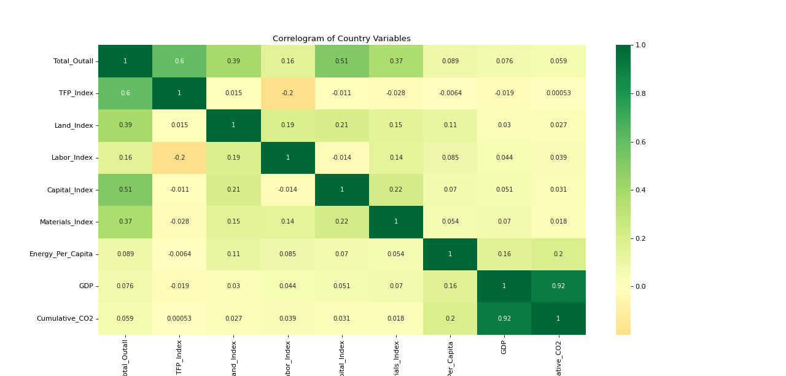
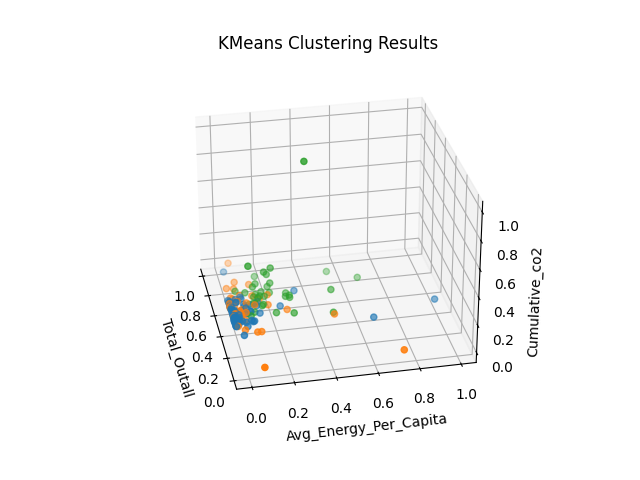
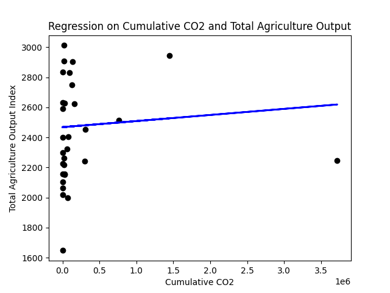

# EcoEnergy Insights

**How do energy use and CO₂ emissions relate to agricultural productivity around the world?**

EcoEnergy Insights combines three public datasets (agricultural productivity from the USDA, plus energy and CO₂ data from Our World in Data) to look at how farming output, energy consumption and emissions changed across countries from 1993 to 2021. We used SQL to join the data, statistical tests to check our hypotheses, and K-means clustering and regression to look for patterns.

Built by a team of 3 as a data science project.



---

## Key findings

| Question | Test | Result |
|---|---|---|
| Did agricultural output change between 2010 and 2021? | Paired t-test across countries | **Yes.** Output rose significantly by 2021 (p < 0.001) |
| Is energy use per person different in the US and China (1993–2021)? | Two-sample t-test | **Yes.** US energy per capita was far higher throughout (p < 0.001) |
| Did cumulative CO₂ emissions change between 2018 and 2021? | Paired t-test across countries | **Yes.** Cumulative emissions rose significantly (p ≈ 0.01) |

**Other takeaways**
- **GDP and cumulative CO₂ move almost together** (correlation 0.92). Bigger economies have emitted far more.
- **Energy use per person barely relates to farm productivity** (correlation under 0.15). Using more energy doesn't mean a country farms more productively.
- **K-means found 3 groups of countries** by farm output, energy per capita and cumulative CO₂ (K chosen with an elbow plot). The groups overlap, so there's no single "type" of country.
- **The regression of farm output on CO₂ was slightly positive,** not negative as we expected, likely because both have grown over time and other factors (technology, policy) confound the relationship.

---

## How it works

1. **Clean the data** (`code_1.py`): load the three datasets with pandas, standardize country names and years, and drop rows with missing values.
2. **Join with SQL**: load the cleaned tables into SQLite and join them by country and year (queries in `correlation_query`, `country_summary` and `country_yearly`).
3. **Test hypotheses** (`stats_tests.py`): paired and two-sample t-tests with SciPy.
4. **Find patterns**: min-max scaling, then K-means clustering (scikit-learn), linear regression (statsmodels) and a correlogram (seaborn).

### Visualizations

| K-means clusters | Regression |
|---|---|
|  |  |

---

## Run it yourself

```bash
pip install pandas numpy scipy scikit-learn statsmodels matplotlib seaborn openpyxl
python3 code_1.py
```

The script prints the test results and opens the charts. The raw datasets are in `data/`.

## Data

- **Agricultural productivity:** USDA International Agricultural Productivity (output, TFP, land, labor, capital and materials indexes)
- **Energy:** Our World in Data energy dataset (energy per capita, GDP)
- **Emissions:** Our World in Data CO₂ dataset (cumulative CO₂)

## Limitations

- Some countries are missing data for certain years, so they were dropped from some tests.
- The tests show that things changed, not why. Policy, technology and the pandemic (2020–2021) could all play a role.
- Correlation is not causation: the regression and clusters show patterns, not causes.

## Project structure

```
EcoEnergy-Insights/
├── code_1.py                 # cleaning, SQL joins, tests, clustering, charts
├── stats_tests.py            # t-tests and regression helpers
├── correlation_query         # SQL: joins all three datasets by country and year
├── country_summary           # SQL: per-country summary
├── country_yearly            # SQL: per-country, per-year output
├── data/                     # raw datasets
├── analysis_deliverable/     # charts
├── data_deliverable/         # data spec and tech report
└── abstract.pdf              # project summary
```
